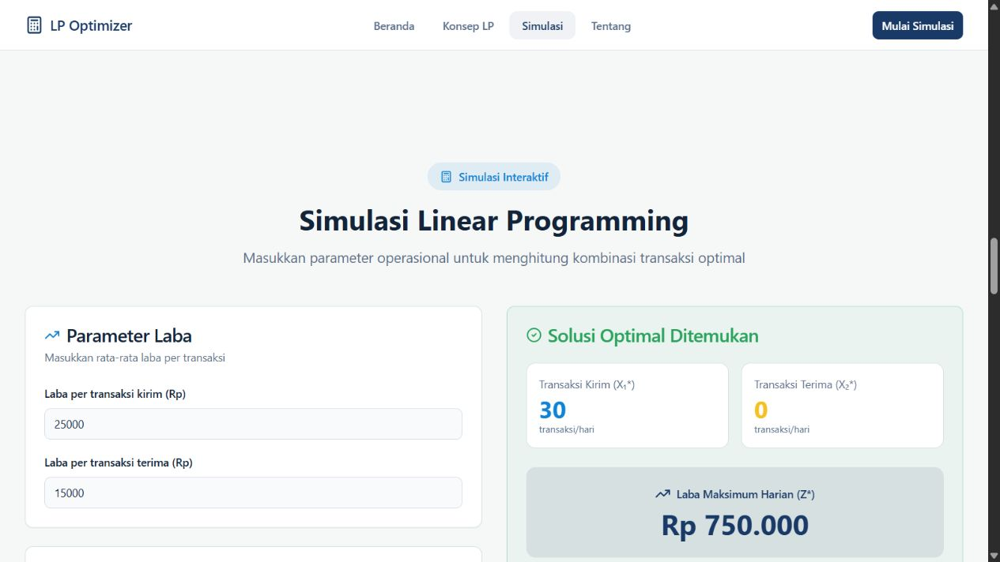

# WU Profit Optimizer

Aplikasi web simulasi optimasi dua jenis transaksi, kirim dan terima, menggunakan model Linear Programming. Pengguna mengubah parameter laba serta kapasitas operasional, lalu membandingkan hasil perhitungan melalui tabel dan grafik.

Proyek ini merupakan implementasi frontend untuk studi pemodelan dan visualisasi. Tidak terhubung ke layanan Western Union, tidak memproses transaksi atau data nasabah, dan tidak merepresentasikan sistem resmi perusahaan tersebut.

## Dokumentasi tampilan



Tangkapan layar aplikasi lokal setelah tombol **Hitung Solusi Optimal** diklik dengan parameter awal. Angka pada gambar adalah keluaran satu skenario contoh; gambar ini tidak membuktikan ketepatan seluruh kasus solver.

## Fitur

- Form parameter laba per transaksi kirim dan terima.
- Batasan waktu frontliner, kapasitas waktu KYC/AML, dan cash float.
- Batas jumlah transaksi kirim dan terima yang dapat diisi secara opsional.
- Perhitungan kandidat solusi untuk model dua variabel.
- Ringkasan jumlah transaksi dan nilai fungsi tujuan.
- Grafik distribusi transaksi, tabel batasan aktif/longgar, dan grafik penggunaan kapasitas.
- Tombol reset untuk mengembalikan parameter awal dan mengosongkan hasil.
- Halaman pengantar konsep, simulasi, dan penjelasan proyek.

## Teknologi

| Bagian | Implementasi |
| --- | --- |
| Antarmuka | React 18, TypeScript, Vite 5 |
| Komponen dan tampilan | Tailwind CSS 3, shadcn/ui, Radix UI, Lucide React |
| Visualisasi | Recharts |
| Perhitungan | Fungsi TypeScript lokal di `src/lib/simplex.ts` |
| Navigasi | React Router |

Seluruh perhitungan berjalan di browser. Aplikasi tidak memerlukan backend, database, API key, atau konfigurasi `.env` untuk menjalankan simulasi yang tersedia.

## Menjalankan secara lokal

Persyaratan: Git, Node.js, dan npm. Repositori belum menetapkan versi Node.js melalui `engines`; gunakan versi yang kompatibel dengan Vite 5.

```sh
git clone https://github.com/samsuldwicahyo/wu-profit-optimizer.git
cd wu-profit-optimizer
npm ci
npm run dev
```

Konfigurasi [vite.config.ts](./vite.config.ts) menetapkan port **8080**. Buka alamat yang tercetak di terminal, biasanya `http://localhost:8080`. Jika port tersebut sedang digunakan, Vite dapat memilih port berikutnya.

### Perintah proyek

| Perintah | Fungsi |
| --- | --- |
| `npm run dev` | Menjalankan server pengembangan. |
| `npm run build` | Membuat build produksi di `dist/`. |
| `npm run build:dev` | Membuat build dengan mode `development`. |
| `npm run lint` | Menjalankan konfigurasi ESLint yang tersedia. |
| `npm run preview` | Meninjau hasil build secara lokal; jalankan build terlebih dahulu. |

## Cara menggunakan simulasi

1. Buka bagian **Simulasi**.
2. Isi laba per transaksi serta kapasitas waktu dan cash float dengan satuan yang tertera pada form.
3. Isi batas maksimum transaksi jika diperlukan; kosongkan jika tidak digunakan.
4. Klik **Hitung Solusi Optimal** untuk menampilkan hasil model.
5. Tinjau ringkasan, distribusi transaksi, dan penggunaan kapasitas. Gunakan tombol reset untuk memulai kembali dari parameter awal.

Nilai awal pada form merupakan parameter contoh. Hasil aplikasi mengikuti asumsi model dan input tersebut.

## Model dan cara kerja

Model menggunakan `x1` untuk jumlah transaksi kirim dan `x2` untuk jumlah transaksi terima. Fungsi tujuan memaksimalkan `labaKirim × x1 + labaTerima × x2` dengan batasan kapasitas berbentuk `a × x1 + b × x2 <= kapasitas` dan variabel nonnegatif.

Fungsi [`solveLPCornerPoint`](./src/lib/simplex.ts) membentuk kandidat dari titik asal, perpotongan dengan sumbu, dan perpotongan pasangan garis batasan. Kandidat yang memenuhi batasan kemudian dibandingkan berdasarkan nilai fungsi tujuan. Status batasan dihitung dari selisih antara kapasitas dan pemakaian (*slack*).

Walaupun nama berkasnya `simplex.ts`, implementasi yang dipanggil antarmuka menggunakan **metode titik pojok untuk dua variabel**, bukan algoritma simplex umum.

### Batasan implementasi

- Model menggunakan variabel kontinu. Hasil jumlah transaksi dapat berupa pecahan dan dibulatkan hingga dua desimal; belum ada pemecahan Integer Linear Programming.
- Solver disusun untuk bentuk model dua variabel dengan batasan `<=`; belum mendukung model LP umum, batasan persamaan, atau operator `>=`.
- Penanganan model tidak terbatas (*unbounded*), tidak layak (*infeasible*), koefisien nol, dan kasus numerik ekstrem masih perlu pengujian lebih lanjut. Status hasil antarmuka belum merupakan jaminan validitas untuk seluruh kemungkinan input.
- Validasi form saat ini memeriksa field wajib agar dapat dibaca sebagai angka nonnegatif. Validasi domain setiap parameter dan batas transaksi opsional masih perlu diperkuat.
- Parameter operasional dimasukkan manual. Tidak tersedia koneksi data transaksi, penyimpanan skenario, atau ekspor hasil.

## Struktur kode

```text
src/
  App.tsx                         # Provider dan route aplikasi
  pages/Index.tsx                  # Susunan halaman utama
  components/
    sections/SimulasiSection.tsx   # Form, validasi, dan pemanggilan solver
    SimulationResults.tsx         # Ringkasan, tabel, dan grafik hasil
    ui/                           # Komponen antarmuka
  lib/simplex.ts                  # Model dan perhitungan titik pojok
vite.config.ts                    # Konfigurasi Vite dan alias @
```

## Rencana pengujian QA

Daftar berikut merupakan **skenario pengujian yang disarankan**, bukan laporan pengujian yang telah lulus. Repositori belum menyediakan script `npm test`.

- [ ] Bandingkan hasil parameter awal dengan perhitungan manual fungsi tujuan dan seluruh batasan.
- [ ] Ubah setiap kapasitas secara terpisah; periksa hasil, *slack*, dan persentase pemakaian.
- [ ] Periksa batas maksimum transaksi ketika kosong, positif, nol, negatif, dan bukan angka.
- [ ] Periksa input wajib ketika kosong, negatif, nol, sangat besar, dan bernilai desimal.
- [ ] Uji garis batasan paralel, model tidak terbatas, dan model tidak layak.
- [ ] Cocokkan angka ringkasan, tabel, grafik, serta interpretasi setelah perhitungan ulang.
- [ ] Pastikan reset mengembalikan semua parameter dan menghapus hasil sebelumnya.
- [ ] Periksa navigasi keyboard, label form, serta tampilan tabel dan grafik di layar ponsel.

## Build dan hosting

Hasil `npm run build` berada di `dist/` dan dapat disajikan melalui hosting statis. Sesuaikan aturan fallback ke `index.html` jika menggunakan navigasi berbasis React Router. Repositori ini tidak menjamin alamat deployment tertentu selalu tersedia.

## Lisensi

Repositori belum memiliki berkas `LICENSE` yang menetapkan lisensi penggunaan secara terpisah.
